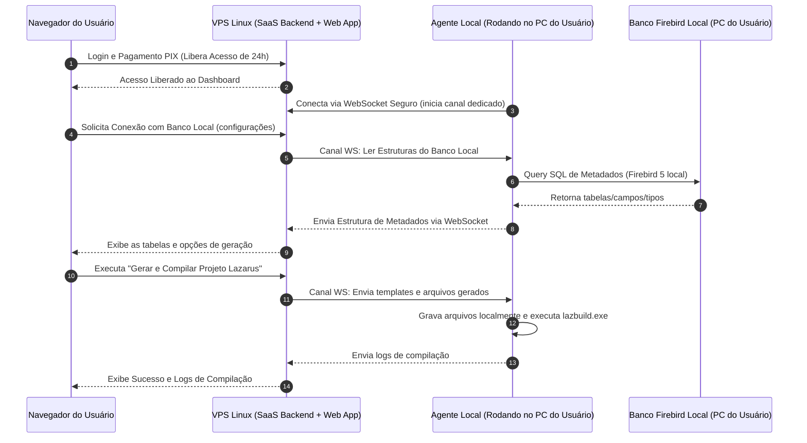

# Plano de Implementação: Gerador Lazarus MVC SaaS

Este documento detalha o planejamento para implantar a ferramenta **Gerador Lazarus MVC** como um modelo **SaaS (Software as a Service)** hospedado em uma VPS Linux sob o subdomínio `gerador.connecttask.com.br`, com um modelo de cobrança "Pay-per-Day" via PIX e integração com o PC local dos usuários por meio de um Agente WebSocket Híbrido.

---

## 🏗️ 1. Arquitetura da Solução Híbrida (Nuvem + Local)

Como a ferramenta precisa ler bancos de dados Firebird locais e rodar o compilador Lazarus (`lazbuild.exe`) na máquina do usuário, uma aplicação 100% em nuvem seria bloqueada pelas políticas de segurança do navegador (Mixed Content/CORS) e pela impossibilidade de acessar o disco local.

Propomos uma **Arquitetura Híbrida baseada em Agente WebSocket**:



### Vantagens dessa Abordagem:
1. **Segurança Absoluta**: O usuário não precisa expor portas de seu banco Firebird para a internet. O agente local faz uma conexão *de saída* segura (WebSocket) com a VPS.
2. **Sem Bloqueios de Navegador**: Evita erros de Mixed Content, permitindo que a interface principal rode sob HTTPS (`https://gerador.connecttask.com.br`) enquanto fala com o PC local de forma criptografada pelo WebSocket da VPS.
3. **Download Rápido**: O código é compilado e colocado diretamente na pasta do usuário remoto, sem necessidade de baixar arquivos zipados pesados.

---

## 🗄️ 2. Banco de Dados do SaaS (Firebird 5)

Criaremos um novo banco de dados no Firebird 5 da VPS (`GERADOR_SAAS.FDB`) com a seguinte estrutura de tabelas:

```sql
/* Domínios para padronização */
CREATE DOMAIN D_ID AS INTEGER NOT NULL;
CREATE DOMAIN D_NOME AS VARCHAR(100) CHARACTER SET UTF8;
CREATE DOMAIN D_EMAIL AS VARCHAR(150) CHARACTER SET UTF8 NOT NULL;
CREATE DOMAIN D_SENHA AS VARCHAR(255) CHARACTER SET UTF8 NOT NULL;
CREATE DOMAIN D_STATUS AS SMALLINT DEFAULT 1;
CREATE DOMAIN D_VALOR AS NUMERIC(15,2) DEFAULT 0;
CREATE DOMAIN D_DATETIME AS TIMESTAMP DEFAULT CURRENT_TIMESTAMP;

/* Tabelas Principais */
CREATE TABLE TB_USUARIOS (
    USU_ID          D_ID,
    USU_NOME        D_NOME,
    USU_EMAIL       D_EMAIL,
    USU_SENHA       D_SENHA,
    USU_IS_ADMIN    SMALLINT DEFAULT 0,
    USU_STATUS      D_STATUS,
    USU_CRIADO      D_DATETIME,
    CONSTRAINT PK_USUARIOS PRIMARY KEY (USU_ID),
    CONSTRAINT UQ_USU_EMAIL UNIQUE (USU_EMAIL)
);

CREATE TABLE TB_DIARIAS (
    DIA_ID          D_ID,
    DIA_USU_ID      D_ID,
    DIA_VALOR       D_VALOR,
    DIA_STATUS      VARCHAR(20) DEFAULT 'pendente', /* 'pendente', 'pago', 'expirado' */
    DIA_PAGTO_REF   VARCHAR(100), /* TXID do Pix */
    DIA_INICIO      TIMESTAMP,
    DIA_FIM         TIMESTAMP,
    DIA_CRIADO      D_DATETIME,
    CONSTRAINT PK_DIARIAS PRIMARY KEY (DIA_ID),
    CONSTRAINT FK_DIA_USU FOREIGN KEY (DIA_USU_ID) REFERENCES TB_USUARIOS(USU_ID)
);

CREATE TABLE TB_PAGAMENTOS (
    PAG_ID          D_ID,
    PAG_USU_ID      D_ID,
    PAG_DIA_ID      D_ID,
    PAG_VALOR       D_VALOR,
    PAG_STATUS      VARCHAR(20) DEFAULT 'pendente',
    PAG_TXID        VARCHAR(100) UNIQUE,
    PAG_COP_COL     BLOB SUB_TYPE TEXT CHARACTER SET UTF8,
    PAG_QRCODE      BLOB SUB_TYPE TEXT CHARACTER SET UTF8,
    PAG_CRIADO      D_DATETIME,
    PAG_CONFIRMADO  TIMESTAMP,
    CONSTRAINT PK_PAGAMENTOS PRIMARY KEY (PAG_ID),
    CONSTRAINT FK_PAG_USU FOREIGN KEY (PAG_USU_ID) REFERENCES TB_USUARIOS(USU_ID),
    CONSTRAINT FK_PAG_DIA FOREIGN KEY (PAG_DIA_ID) REFERENCES TB_DIARIAS(DIA_ID)
);

CREATE TABLE TB_CONFIG (
    CFG_CHAVE       VARCHAR(50) NOT NULL PRIMARY KEY,
    CFG_VALOR       VARCHAR(255) CHARACTER SET UTF8
);

/* Sequences para auto-incremento */
CREATE SEQUENCE SEQ_USUARIOS;
CREATE SEQUENCE SEQ_DIARIAS;
CREATE SEQUENCE SEQ_PAGAMENTOS;
```

> [!IMPORTANT]
> **Conta Admin Padrão:**
> Ao rodar o script de inicialização do banco de dados, criaremos a conta padrão informada:
> - **Usuário:** `conectsolutions@hotmail.com`
> - **Senha:** `Mmpa@2025` (com hash bcrypt seguro)
> - **Perfil:** Admin (`USU_IS_ADMIN = 1`)

---

## 💳 3. Regra de Negócio: Pay-per-Day (Pague quando usar)

1. **Acesso Condicional**: Ao fazer login, o sistema busca na tabela `TB_DIARIAS` se o usuário possui uma diária onde `DIA_STATUS = 'pago'` e o horário atual está entre `DIA_INICIO` e `DIA_FIM`.
2. **Redirecionamento para Pagamento**: Se não possuir diária ativa, o usuário é bloqueado e direcionado à tela de checkout onde é gerado um QR Code Pix dinâmico (com o valor parametrizado na tabela `TB_CONFIG` sob a chave `'VALOR_DIARIA'`).
3. **Liberação**: 
   - O sistema monitora o recebimento do Pix por meio de webhook ou de uma rota de simulação manual de pagamento (caso não haja gateway configurado inicialmente).
   - Assim que o pagamento é confirmado, uma nova diária é ativada para as próximas **24 horas** (ex: `DIA_INICIO = CURRENT_TIMESTAMP` e `DIA_FIM = DATEADD(1 DAY TO CURRENT_TIMESTAMP)`).
4. **Nova cobrança**: Expiradas as 24 horas, no próximo login ou acesso à ferramenta, um novo Pix é solicitado.

---

## 🖥️ 4. Telas e Funcionalidades do Frontend

### A. Fluxo Público
- **Tela de Login**: Autenticação limpa e moderna.
- **Tela de Cadastro**: Criação de conta coletando Nome, E-mail e Senha.
- **Esqueci minha Senha**: Envio de token de recuperação para o e-mail cadastrado (via Nodemailer).

### B. Dashboard do Usuário
- **Status do Acesso**: Mostra o tempo restante da diária ativa (ex: "Acesso ativo por mais 18h 12m") ou botão para renovar se expirado.
- **Download do Agente Local**: Link para baixar o arquivo executável ou script do agente local (Node.js/empacotado) que o usuário precisa rodar no seu computador local.
- **Configuração da Conexão**: Inputs para selecionar o caminho do banco Firebird local, nome do projeto e pasta local onde o Lazarus está instalado.
- **Gerador & Compilador**: Seleção de tabelas, templates e acionamento da geração/compilação que envia os sinais ao agente local via WebSocket.

### C. Painel do Administrador (Admin Panel)
- **Controle de Usuários**: Visualização, bloqueio e edição de perfis de usuários.
- **Financeiro**: Relatório completo das transações Pix (Faturamento do dia/mês, lista de pagamentos confirmados e pendentes).
- **Parametrização**: Campo para alterar o valor da diária (armazenado em `TB_CONFIG`).

---

## 🚢 5. Plano de Implantação na VPS Linux

1. **Configuração de Dependências da VPS**:
   - Instalar Node.js LTS, Firebird 5.
   - Configurar o banco de dados `GERADOR_SAAS.FDB`.
2. **Configuração de Certificados e Proxy**:
   - Configurar o Nginx como proxy reverso para direcionar o subdomínio `gerador.connecttask.com.br` para a porta do backend e frontend.
   - Instalar certificado SSL gratuito da Let's Encrypt (`certbot`).
3. **Distribuição do Agente Local**:
   - Criar uma pasta `/public/agent` no backend contendo o script do agente local pré-configurado para conectar no IP/DNS da VPS.
4. **Gerenciamento de Processos**:
   - Utilizar o PM2 na VPS para manter o backend e frontend rodando continuamente.

---

## 🧪 Plano de Validação do Plano

### Teste de Fluxo Completo:
1. Cadastrar usuário novo na tela de login.
2. Logar com a conta e certificar-se de ser bloqueado com a cobrança do Pix.
3. Simular o pagamento do Pix e verificar se o acesso é destravado por 24 horas.
4. Iniciar o Agente Local no computador remoto e verificar se a conexão WebSocket com a VPS é estabelecida com sucesso.
5. Selecionar uma tabela do banco local, clicar para gerar e validar se os arquivos surgiram fisicamente na pasta local do PC do usuário e se o Lazarus compilou o programa remotamente de forma correta.
6. Acessar com a conta `conectsolutions@hotmail.com` e checar se o painel administrativo exibe os relatórios financeiros e a configuração de preço.
